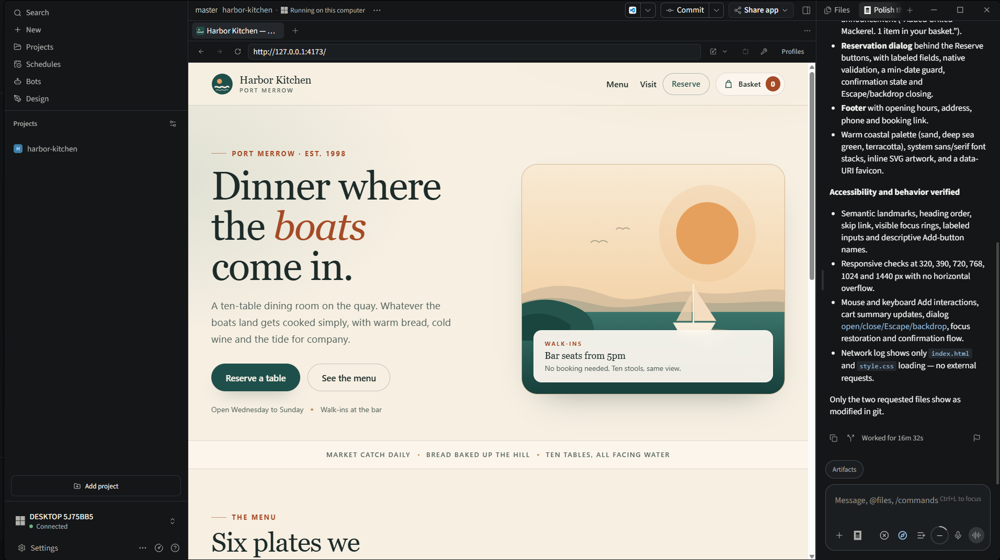
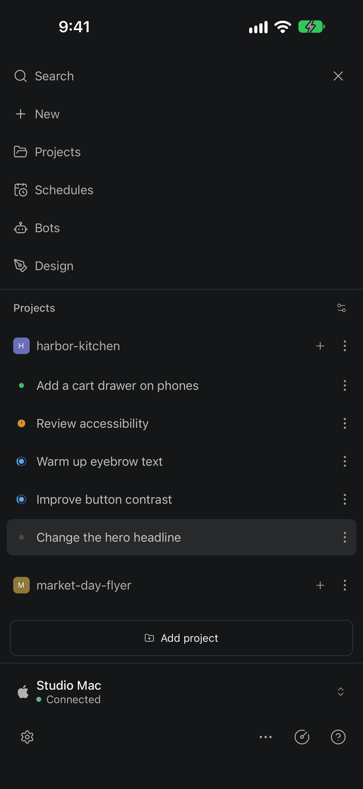
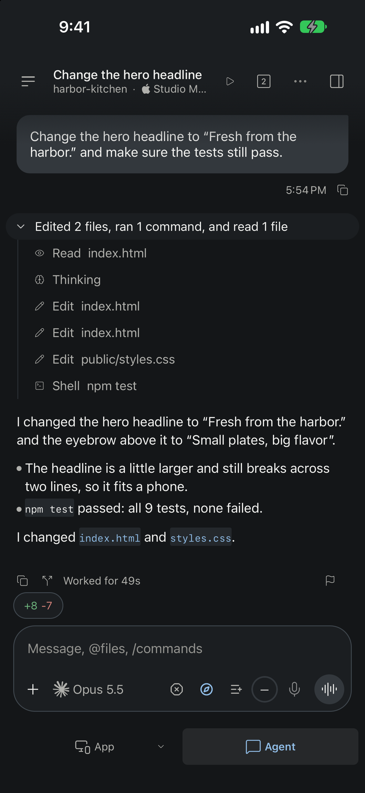
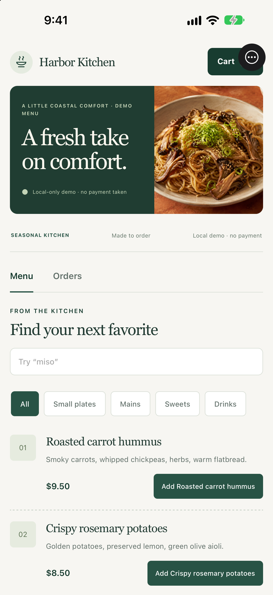
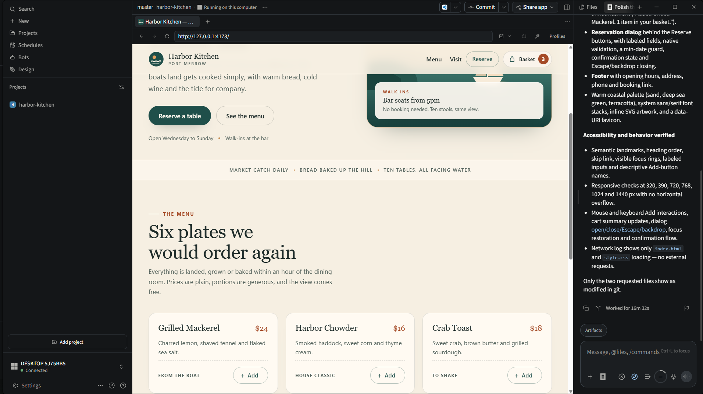
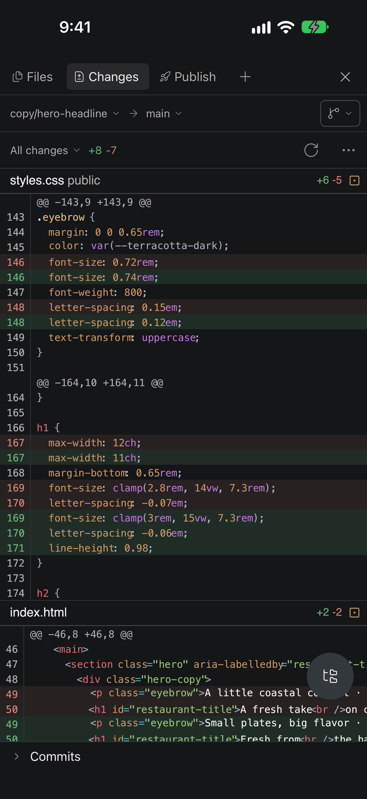
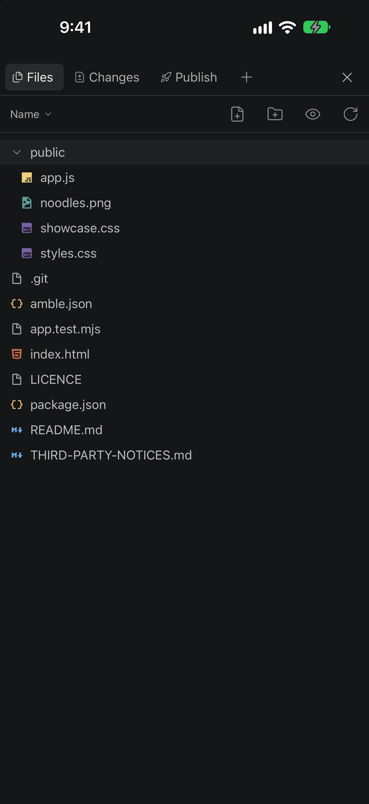
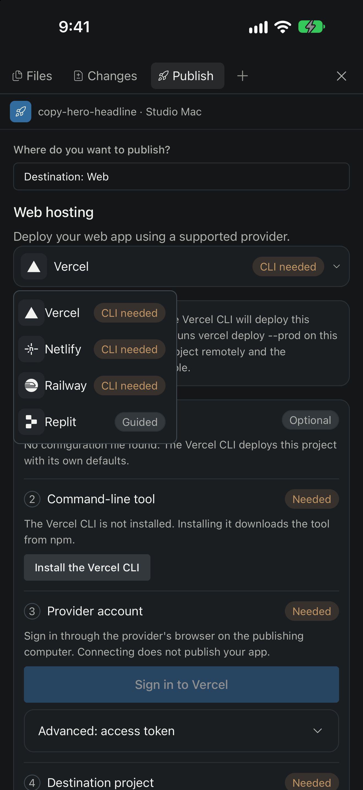
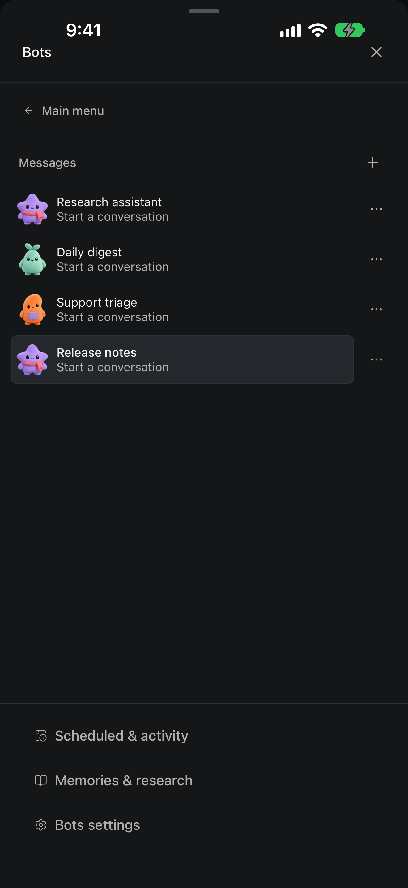

<p align="center">
  <a href="https://www.amblecode.com"></a>
</p>

<h1 align="center">Amble</h1>

<p align="center"><strong>Build locally. Take it with you.</strong></p>

<p align="center">Coding agents, your models, and your running app, in one workspace on your computer.<br>Drive it from your phone, tablet, or another computer.</p>

<p align="center">
  <a href="https://github.com/AmbleCode/amble-releases/releases/latest"><strong>Download Amble →</strong></a> ·
  <a href="https://www.amblecode.com/docs/quickstart.html">Get started</a> ·
  <a href="TEAMWORK.md">Team guide</a> ·
  <a href="https://www.amblecode.com">Website</a> ·
  <a href="https://discord.gg/eGjaBGJgp">Discord</a>
</p>

<p align="center">
  <a href="https://github.com/AmbleCode/amble-releases/stargazers">
    
  </a>
  <a href="https://github.com/AmbleCode/amble-releases/releases/latest">
    
  </a>
  <a href="https://x.com/BakhitJonathan">
    
  </a>
  <a href="https://discord.gg/eGjaBGJgp">
    
  </a>
  <a href="https://www.linkedin.com/in/jonathanbakhit/">
    
  </a><br>
  <sub>macOS · Windows · Linux · Early access</sub>
</p>

<p align="center">
  
</p>

## What is an Agentic Development Environment?

An IDE is built around you typing code. An **Agentic Development Environment** is built
around agents doing the work while you direct and review it. Amble gives them a real
place to work: your projects, terminals, Git worktrees and a live preview of the app they
are building, all on **a computer you own**. You steer it from your phone.

<table>
  <tr>
    <td width="33%" valign="top"></td>
    <td width="33%" valign="top"></td>
    <td width="33%" valign="top"></td>
  </tr>
  <tr>
    <td valign="top"><strong>1. Pick up your work.</strong> Your projects and running agents, on your computer.</td>
    <td valign="top"><strong>2. Follow the agent.</strong> Every edit and command, and the tests it ran.</td>
    <td valign="top"><strong>3. Try the result.</strong> The app the agent built, running in a live preview.</td>
  </tr>
</table>

- **Agents do the work.** Run Claude Code, Codex, GitHub Copilot, OpenCode and Pi side by side, on your own keys or local models.
- **Your computer is the home base.** Projects, previews and agents run there, with no Amble cloud account needed for local use.
- **Any paired device steers it.** Follow, review and answer from a phone, tablet or another computer, directly or through an end-to-end encrypted relay.
- **You stay in control.** Review the actual changes, decide what is shared, and revoke access at any time.

<p align="center">
  <a href="assets/amble-tour.mp4"><strong>▶ Watch a 30-second tour of the real workspace</strong></a>
</p>

## A thin client for your agentic development studio

Amble keeps the work on **your computer**: projects, agents, terminals, builds and previews.
Your phone, tablet or another computer is a proper **thin client** to that studio. It shows
what is happening and lets you steer it, while nothing runs in an Amble cloud. These features
exist to make remote development practical:

- **Reach it your way.** Connect directly over your local network, VPN or Tailscale at no cost, or through an end-to-end encrypted relay on Premium and above. Pair a device once and it stays yours to revoke.
- **See the running app, not a description of it.** Try the preview the agent started on your computer from your paired device. Local-network viewing is free; viewing over the relay needs Premium or above.
- **Know when an agent needs you.** Activity groups work into **Needs your input**, **Ready to review** and **Working**, and notifications tell you when a task finishes. Looking at Activity never clears it.
- **Review and decide from anywhere.** Read the actual diff in **Changes**, run checks in terminals, commit, and answer an agent's permission request without going back to your desk.
- **Hand work between computers.** Send a file to another connected computer, or dispatch agent work to it and its available models.
- **Take over the whole screen when you must.** Built-in remote desktop (early) shows and controls a connected computer, with consent for each session and no Docker, RDP server or gateway to set up.
- **Share an app, not the code.** Invite a tester with a single-use link or QR code and revoke it at any time.

The host computer must stay awake and connected, and each provider's accounts, installation
and costs stay yours. Relay, remote viewing hours and other limits depend on your plan; see
[plans](https://www.amblecode.com/#pricing) and the [release status](https://www.amblecode.com/docs/release-status.html).

## Key Features

**Agents and models**

- **Your coding agent, your model.** Run Claude Code, Codex, GitHub Copilot, OpenCode and Pi side by side, organized by project. Provider accounts, installation and model access vary by provider.
- **One composer.** Send, steer, interrupt or queue a message while an agent works, and watch Usage and Context as it goes. Agents decide when to hand work to helper agents.
- **Subagents.** Delegate independent parts of a task to helper agents, follow the children your conversation started, and review their results.
- **Cloud and local models.** Connect provider accounts or API keys, or add Ollama, LM Studio, llama.cpp or a compatible local server. Browse a shared model catalog, set routes and see usage. No model weights are bundled.
- **Bots.** Named specialist assistants with their own instructions, computer rules, memory and schedules, working in the background while you are away. See [Bots](#bots-specialists-that-keep-working).

**Build and review**

- **Live app previews.** Try your running app beside the conversation. Agents and previews start and stop independently.
- **Visual feedback.** Attach a preview screenshot to your next message; supported desktop previews also let you pick an element.
- **Git worktrees, Changes and commits.** Give independent work its own checkout, read the actual diff, stage and commit from the workspace.
- **Built-in terminals and CLI profiles.** Run your project's checks next to the chat and preview.
- **Review before you publish.** A guided Publish flow shows the destination and release effect before anything runs. Setup is not a completed store submission.
- **Schedules, Activity and notifications.** See what needs your input, is ready to review or is still running, and run recurring agent tasks while the host stays available.

**Every device**

- **Continue from a paired phone, tablet or computer.** Connect directly on your network or through an end-to-end encrypted relay. The host computer must stay awake and connected.
- **Built-in remote desktop (early).** View and control a connected computer's whole screen with no Docker, RDP server, gateway or SDK. Each session asks for consent.
- **Share an app, not the code.** Invite testers with a single-use link or QR code. App-only access leaves source files, agent sessions, terminals and settings private, and you can revoke it.
- **Agent work across computers.** Plan and dispatch agent work to other connected computers and their available models.

**Teams and extras**

- **Clear access.** Owners hold the host's authority; Viewers get only the apps you share, never agents, source, terminals or settings. Revoke either at any time.
- **Add-ons and plugins.** Tool extensions and interface plugins appear in one Plugins inventory with trust and compatibility checks. Listing is not installation.
- **Local first.** Local projects and local-network use need no Amble cloud account. Amble Cloud is a separate paid add-on that is still being rolled out.

More detail on each: [Choose your coding agent](FEATURES.md#your-choice-of-coding-agent) ·
[Live previews](FEATURES.md#live-app-previews) · [Other devices](FEATURES.md#continue-from-another-device) ·
[Subagents](FEATURES.md#subagents-for-independent-tasks) · [Worktrees](FEATURES.md#separate-git-worktrees) ·
[Review and commit](FEATURES.md#review-and-commit-changes) · [App sharing](FEATURES.md#share-an-app-with-testers) ·
[Remote desktop](FEATURES.md#built-in-remote-desktop) · [Models and routing](FEATURES.md#local-models-and-routing) ·
[Schedules](FEATURES.md#schedules-activity-and-notifications) · [Publishing](FEATURES.md#review-before-publishing)

[**Explore all features →**](FEATURES.md)

## Try a complete workflow

- [Use Claude Code from your phone](https://www.amblecode.com/docs/claude-code-from-phone.html).
- [Use Codex from your phone](https://www.amblecode.com/docs/codex-from-phone.html).
- [Share a local app with a tester](https://www.amblecode.com/docs/share-local-app-with-tester.html).
- [Evaluate Amble with the facts and review guide](https://www.amblecode.com/docs/lyre-facts-and-review-guide.html).

Check [current host and client availability](https://www.amblecode.com/docs/release-status.html)
before trying a workflow. The review guide explains the running-host requirement,
preview scope, access limits and separate provider costs.

## Get Amble

[**Download the latest release →**](https://github.com/AmbleCode/amble-releases/releases/latest)

| Your computer                    | Recommended download                              | Availability         |
| -------------------------------- | ------------------------------------------------- | -------------------- |
| **macOS · Apple silicon**        | **.dmg**: open it, then drag Amble to Applications | Signed and notarized |
| **Windows · Intel / AMD 64-bit** | **Setup .exe** installer                          | Available · unsigned |
| **Linux · Intel / AMD 64-bit**   | **AppImage**, or **.deb / .rpm**                  | Available · unsigned |

No Intel Mac package is currently published. iOS and Android clients have separate
testing and distribution channels; check [mobile availability](https://www.amblecode.com/docs/release-status.html#ios).

[Installation and updates](INSTALL.md) · [Release notes](https://github.com/AmbleCode/amble-releases/releases) ·
[Compare plans](https://www.amblecode.com/#pricing)

### Use Amble from your terminal

The npm package installs the **CLI and host daemon** for managing projects,
workspaces and coding agents. Download the desktop app above for the graphical
workspace. The host runs your projects and agents; connected clients let you
follow and control that work.

Requires **Node.js 22.12 or newer**, with npm. The initial npm release is verified
on **Windows x64 with Node.js 24**; installed macOS/Linux qualification is pending.

```sh
npm install --global @amble/cli@beta
amble --version
amble --help
```

If you already use Amble desktop, try `amble status` to check the selected
host. To run a standalone host from npm, start its background daemon:

```sh
amble daemon start
amble status
amble provider ls
```

Install and sign into a supported coding provider before starting an agent.
From an existing project folder, this example uses Codex to explain the project:

```sh
amble project create .
amble run --provider codex --cwd . "Explain this project without changing files."
amble ls
```

Choose an available provider shown by `amble provider ls`; replace `codex` if you
use another. To follow a task, use `amble logs AGENT_ID --follow`, replacing
`AGENT_ID` with its ID from `amble ls`. Use `amble pair` to approve a trusted
client and obtain connection instructions; review the requested owner access.

The npm CLI is **0.11.0-beta.3**, accompanying desktop **0.1.11**. The `amble` and
`amble-foundation` commands are aliases for the same CLI. npm installs
the required runtime packages automatically.

[npm package](https://www.npmjs.com/package/@amble/cli) ·
[Full CLI walkthrough, updates and troubleshooting](INSTALL.md#command-line-interface)

[Website CLI quickstart](https://www.amblecode.com/docs/cli-quickstart.html) ·
[Command reference](https://www.amblecode.com/docs/cli.html) ·
[Amble CLI workflows](https://www.amblecode.com/docs/cli-workflows.html)

### Amble features you can use from the CLI

The CLI brings more of Amble's development workflow to your terminal:

| Feature                    | How to use it                                                                                                                                                                                                                              |
| -------------------------- | ------------------------------------------------------------------------------------------------------------------------------------------------------------------------------------------------------------------------------------------ |
| **Provider modes**         | Use `amble run --mode MODE` when your provider offers modes such as a plan mode. `amble provider ls` lists the modes each provider supports.                                                                                                |
| **Separate Git worktrees** | Add `--new-workspace worktree --new-branch fix-login` to a run to work in a separate checkout. Reuse it later with `--workspace WORKSPACE_ID`.                                                                                             |
| **Screenshot context**     | Send an image to an existing agent with `amble send AGENT_ID --image screenshot.png "Explain this screenshot."`, then review the transfer prompt. The selected provider must support images.                                                |
| **App preview setup**      | Inspect your project with `amble preview inspect . --json`, review a configuration with `amble preview plan . --port 5173 --json`, and control workspace services with `amble script start` / `stop`. Agents and services stop independently. |
| **Recurring agent tasks**  | Use `amble schedule create` with a cadence and provider; inspect run history and pause or resume the schedule. The host must stay running.                                                                                       |
| **Permission review**      | Use `amble permit ls` to see pending requests, then approve or deny a specific request after reviewing it.                                                                                                                                  |
| **Host plugins**           | Use `amble plugin ls`, statically check a plugin with `amble plugin check`, and review available updates with `amble plugin update --all --check`. Install only code you trust.                                                               |

Preview viewing,
app-sharing invitations and whole-desktop control use the supported Amble clients.

[**See complete CLI examples for these features →**](INSTALL.md#amble-features-from-the-terminal)

## Major features

[**Explore the feature showcase →**](FEATURES.md)

### Build together, with clear project access

Work with teammates on the same project from connected computers and mobile
clients. See the work already underway, divide the next steps, and validate the
result together.

1. **Choose who can do what.** Owners hold the host's authority. Viewers get only
   the apps you share, never agents, source, terminals or settings.
2. **Follow the same work.** Open accessible agent conversations in the project's
   workspace to read requests and responses. Shared pending requests carry device
   labels, helping you spot a task that is already queued.
3. **Bring feedback into the conversation.** Ask about an agent's result or send a
   correction in the same chat. Use inline code review comments where your
   connection supports them, then send the review to the agent.
4. **Divide tasks and edits.** Use separate conversations for independent jobs and
   Git worktrees for separate checkouts. Supporting builds can plan and dispatch
   agent work across connected computers with their available models.
5. **Check the result together.** Review the changes and tests, integrate the
   branches, and let teammates try the running app on their devices.

Shared visibility helps people avoid duplicate work; the team still agrees on
ownership and reviews overlapping changes. Owner access runs with the host
account's permissions, so grant it only to people you trust.
Available controls depend on the connection role and installed versions.

[**Set up your team and follow a complete workflow →**](TEAMWORK.md)

### Every agent, one composer

Bring the coding agent you already use: **Claude Code, Codex, GitHub Copilot, OpenCode,
and Pi** run side by side, organized by project. One composer drives all of them. Send a
message while an agent works and choose whether it **steers** the current turn, **queues**
for the next, or **interrupts**. Agents decide when to delegate to helper agents, and a
provider's own modes, such as a plan mode, stay available where it offers them.

Run independent work in separate **Git worktrees**, queue follow-up messages, dictate
by voice, and attach screenshots or files. Provider accounts, installation, and model
access vary by provider.

### Your app, live, beside the chat

Start your project's preview with **Open app** and try it next to the conversation,
or open it on its own. Agents and previews have independent lifecycles: stopping one
doesn't stop the other. Attach a preview screenshot to the next message when
something looks off.

<p align="center">
  
</p>

### Review before you ship

Inspect every changed file in the **Changes** view, read the actual diff, and run
your project's tests in built-in **terminals**. Commit, open a pull request, or
keep iterating. A running app is something you can try; your checks decide whether
it's ready.

<p align="center">
  
</p>

### Your models, your way

- **Cloud providers:** connect Anthropic, OpenAI, and other supported sources with
  named, host-stored key profiles or managed setup.
- **Local models:** add **Ollama, LM Studio, llama.cpp**, or a compatible server and
  use its models like any other. No model weights are bundled.
- **Routing:** browse a shared model catalog, set routes, and see a live route map
  and usage report.

Local inference depends on your hardware and the chosen agent's model support.

<p align="center">
  
</p>

### Continue on any device

Your computer runs the projects and agents; **paired clients** pick up the same work.
Follow an agent, review its changes, try a website by touch, or play the browser
game you're building from your phone. Connect directly on your network or through an
**end-to-end encrypted relay**. The host must stay awake and connected.

<p align="center">
  &nbsp;
  
</p>

### Your whole desktop, built in

Open a connected computer's **entire screen** from Amble and take control, for the
tools that don't live in a browser: a game engine, a design app, a build monitor.
Remote desktop is native to Amble, so a normal install needs **no Docker, RDP server,
gateway, or SDK**. Each session asks for consent, and pairing alone never grants
desktop access. _Early: cross-device qualification is ongoing, and support depends on
platform, permissions, and build._

### Share the app, not the code

Invite a tester with a **single-use link or QR code**. **App-only access** lets them
use the app you shared, while source files, agent sessions, terminals, and computer
settings stay private. Revoke access at any time. For a public URL, **opt-in public
service links** require both your grant and an access token. Client support varies by
platform and plan; see [plans](https://www.amblecode.com/#pricing).

### Bots: specialists that keep working

Create a **Bot**, name it, give it instructions and choose the context it can use. A Bot is a
specialist assistant that keeps its own conversations, memories and research, and works when
you ask or on a schedule, so a recurring job like a daily digest or a release-notes draft
doesn't need you at the keyboard.

<p align="center">
  
</p>

- **Their own computer rules.** A Bot runs on the computer its chat started on, with its own computer rules, a host egress filter and dry-run approvals for what it may do.
- **Start from real events.** Start saved tasks from verified GitHub, Linear and Sentry events, and route work between Bots with @mentions.
- **Schedules you can see.** Browse schedules in a calendar view. Recurring runs that would overlap skip, and the desktop stays awake while scheduled Bots run.
- **Memory you review.** Bots keep research and memories on your host, and proposed learning is reviewed before it is saved.
- **Connections you grant.** Each connected account or tool is enabled on its own, with its own Ask first setting. Creating a Bot grants none of them.
- **Group them by project.** Keep related Bots together under one project.
- **Add roles and goals (optional).** The separate **Amble Organization** add-on gives Bots roles and goals, such as a CEO, coordinators and workers, with advisory budgets. Roles grant no permissions.

Bots run on your computer, so it must stay awake and connected. Connected accounts, browser
control and posting to outside services need your explicit grant, and a Bot's name or
instructions never grant them. Provider accounts and costs stay yours.

### It keeps working while you're away

**Activity** groups work that needs your input, is ready to review, or is still
running. **Schedules** run recurring agent tasks, and **notifications** tell you when
work finishes or a preview becomes ready.

### Flexibility with ready-made Add-ons

Amble turns popular public projects into **Add-ons** you can try yourself. There is
nothing to evaluate separately first: an Add-on works exactly like an **Extension**,
with the same trust, compatibility and platform checks. Add one, try it, and remove
it if it isn't for you.

## What's supported

|                    | Supported today                                                                            |
| ------------------ | ------------------------------------------------------------------------------------------ |
| **Host computers** | macOS (Apple silicon), Windows 64-bit, Linux 64-bit                                        |
| **Clients**        | Amble desktop app; iOS and Android apps in testing                                   |
| **Coding agents**  | Claude Code, Codex, GitHub Copilot, OpenCode, Pi                                           |
| **Model sources**  | Provider accounts and API keys; Ollama, LM Studio, llama.cpp, and compatible local servers |
| **Connections**    | Direct on your local network or VPN, or through an end-to-end encrypted relay              |
| **Previews**       | Web apps and browser games served by your project, on the desktop and on paired clients    |
| **Remote desktop** | Built-in whole-desktop viewing and control (early)                                         |
| **Accounts**       | Local projects and local-network use need no Amble cloud account                            |

<details>
<summary><strong>More in the workspace: publishing, plugins, and customization</strong></summary>

- **Publish and deploy:** prepare mobile releases with integrated Fastlane tools, your
  signing setup, platform tooling, and store accounts. Setting up isn't the same as a
  completed store submission.
- **Plugins:** one inventory for tool extensions and interface plugins. Design and Video
  Editor come with the app; others install as add-ons.
- **Projects:** find recent work across computers, group projects, and
  import sessions started in a terminal.

</details>

## Your first development loop

1. **Open a project.** Choose the folder on the computer that will run it.
2. **Connect an agent or model.** Follow its installation and account setup.
3. **Make a change and try it.** Ask for a change, press **Open app**, and review the
   agent's work.
4. **Connect another device.** Use **Pair Device** with a supported client and
   explicitly grant the access it needs.

[First-project guide](https://www.amblecode.com/docs/quickstart.html) ·
[Existing projects](https://www.amblecode.com/docs/projects.html) ·
[App recipes](https://www.amblecode.com/docs/app-recipes.html)

Amble is in early access. Capabilities depend on the installed build, provider,
platform, and configured services. [Release notes](https://github.com/AmbleCode/amble-releases/releases)
list version-specific changes and known limitations.

## Help shape Amble

[Report a bug](https://github.com/AmbleCode/amble-releases/issues/new?template=bug_report.yml) ·
[Request a feature](https://github.com/AmbleCode/amble-releases/issues/new?template=feature_request.yml) ·
[Join Discord](https://discord.gg/eGjaBGJgp) ·
[Read the docs](https://www.amblecode.com/docs/index.html)

For security issues, use [private reporting](SECURITY.md).

---

This is Amble's official repository for **downloads, release notes, and
feedback**. Application source is maintained privately. **Amble is proprietary**;
see the [license notice](LICENSE), [EULA](https://www.amblecode.com/legal/eula.txt), and
[third-party licenses](https://www.amblecode.com/legal/third-party-licenses.html).
The application foundation derives from [Paseo](https://github.com/getpaseo/paseo),
with its Apache-2.0 license and notices preserved.

<p align="center"><sub>© 2026 Jonathan Bakhit · Amble · <a href="https://www.amblecode.com/privacy.html">Privacy</a></sub></p>
